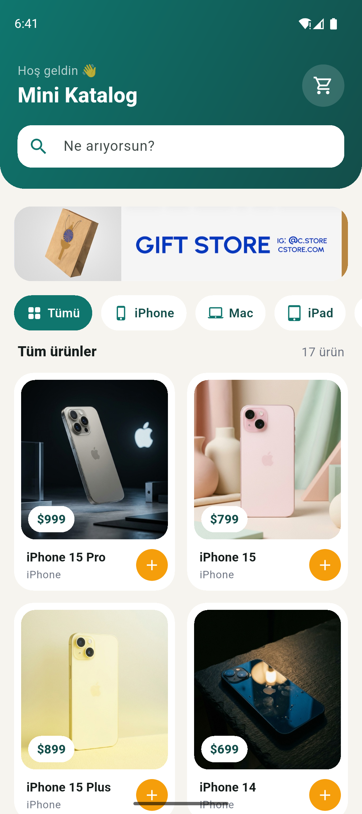
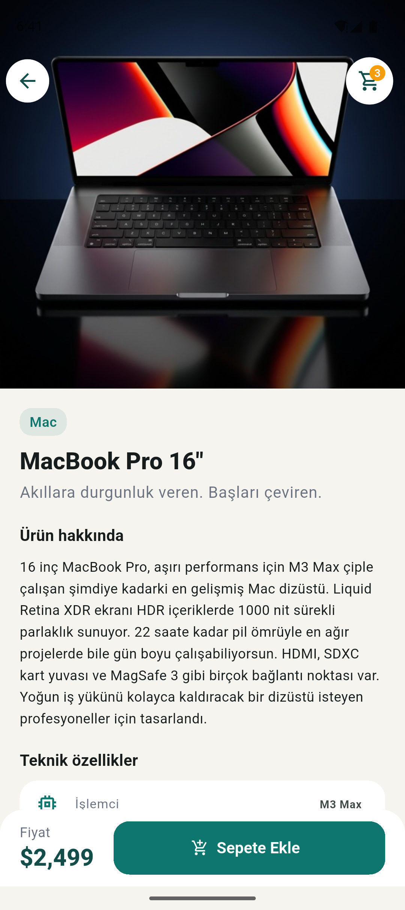
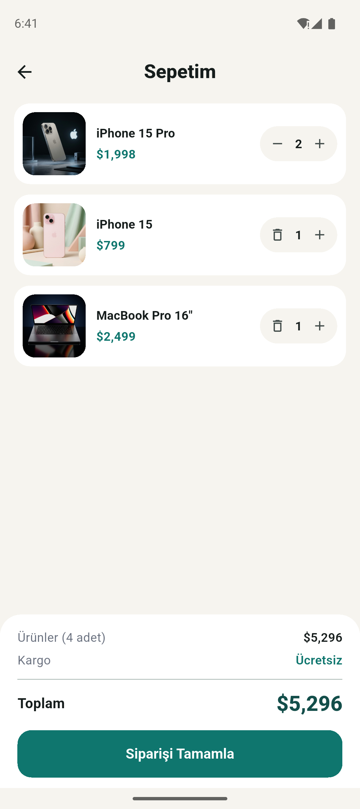
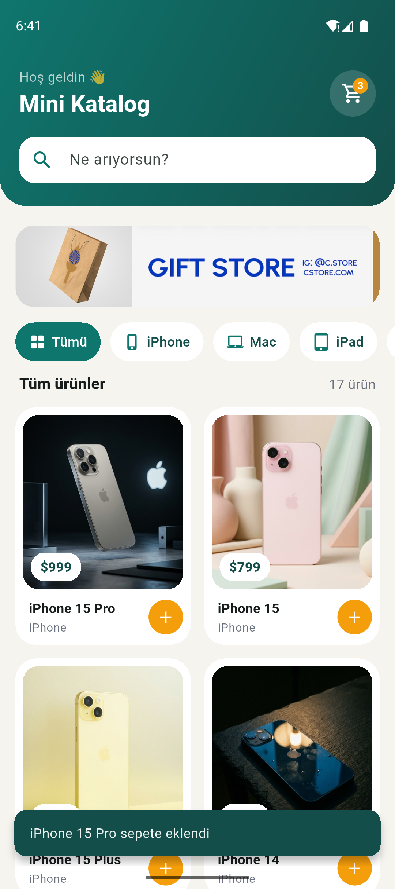
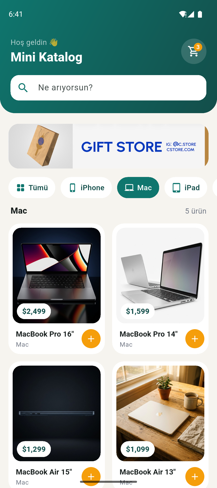
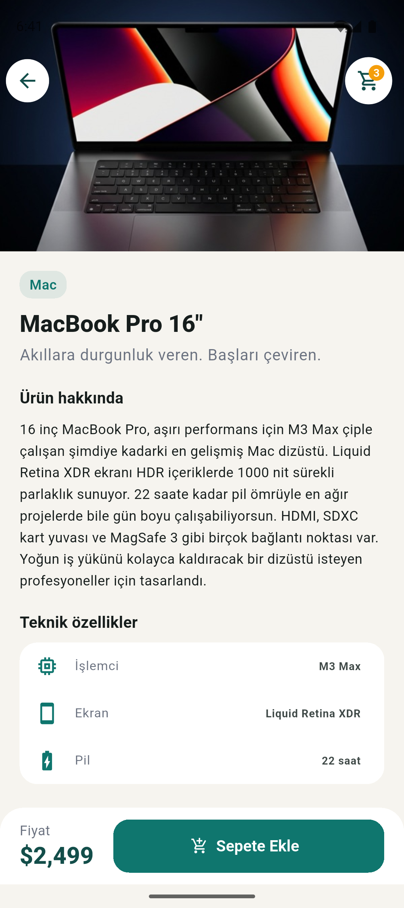
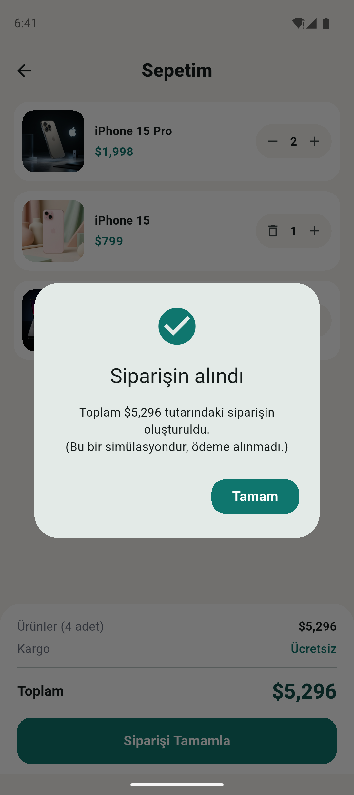
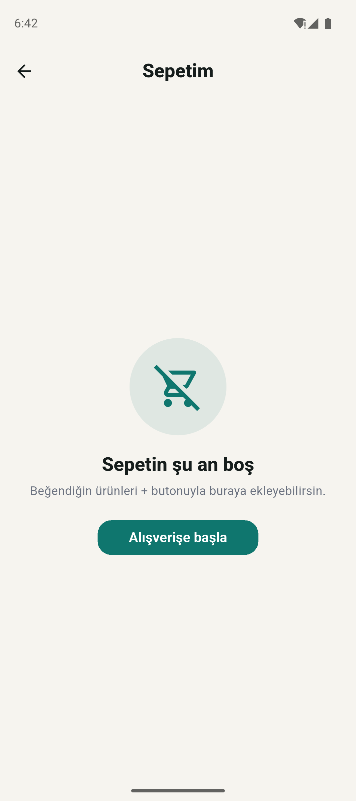

# Mini Katalog

Flutter ile yaptığım basit bir ürün katalog uygulaması. Mobil Uygulama Geliştirme (Flutter) eğitiminin proje ödevidir.

Uygulamada ürünler kart şeklinde listeleniyor. Ürünler aranabiliyor ve kategoriye göre filtrelenebiliyor. Bir ürüne dokununca detay sayfası açılıyor; ürün sepete eklenebiliyor ve sepetten sipariş verme işlemi simüle ediliyor.

<p>
  
  
  
</p>

## Kullanılan Flutter sürümü

- Flutter 3.47.9 (stable)
- Dart 3.13.7
- Paket olarak sadece Flutter'ın kendi `material.dart` kütüphanesi kullanıldı, ekstra paket yok.

## Özellikler

- **Ana sayfa:** Banner, arama kutusu, kategori filtreleri ve `GridView` ile iki sütunlu ürün kartları
- **Arama ve filtreleme:** Ürün adına göre arama; iPhone, Mac, iPad, Watch ve Ses & Diğer kategorileri
- **Ürün detayı:** Büyük görsel, açıklama, teknik özellikler ve fiyat. Ürün, detay sayfasına route argument olarak gönderiliyor.
- **Sepet (simülasyon):** Karttaki + butonuyla ya da detay sayfasından sepete ekleme, adet artırma/azaltma, toplam tutar ve sipariş onayı
- **Named routes:** `/` ana sayfa, `/detail` ürün detayı, `/cart` sepet

## Çalıştırma adımları

1. Flutter SDK'yı kurun ve `flutter doctor` ile kontrol edin.
2. Projeyi indirin ve klasörüne girin:

   ```bash
   git clone <repo-adresi>
   cd <repo-klasoru>
   ```

3. Bağımlılıkları yükleyin:

   ```bash
   flutter pub get
   ```

4. Android emülatörünü açın (veya telefonu USB ile bağlayın) ve uygulamayı çalıştırın:

   ```bash
   flutter run
   ```

Testleri çalıştırmak için:

```bash
flutter test
```

## Klasör yapısı

```
lib/
  main.dart                  uygulamanın başlangıcı, tema ve route tanımları
  models/product.dart        ürün model sınıfı (fromJson / toJson)
  data/product_repository.dart   assets'teki JSON'u okuyup ürün listesine çeviriyor
  state/cart.dart            sepet simülasyonu
  pages/                     ana sayfa, ürün detayı ve sepet sayfaları
  widgets/                   ürün kartı ve sepet ikonu
  theme/app_theme.dart       renkler ve tema
assets/
  data/products.json         ürün verileri
  images/                    ürün görselleri ve banner
test/                        model ve sepet testleri
ekran-goruntuleri/           uygulamanın ekran görüntüleri
```

## Veri kaynağı

Ürün verileri ve banner görseli, yönergede verilen eğitim amaçlı demo kaynaktan (wantapi.com) alındı. Ekstra paket kullanmamak için veriyi internetten çekmek yerine `assets/data/products.json` dosyasına koydum ve uygulama açılırken bu dosyadan okuyorum. Ürün açıklamalarını Türkçeye çevirdim. Ürün adları ve markalar sahiplerine aittir.

## Ekran görüntüleri

| Ana sayfa | Hızlı sepete ekleme | Kategori filtresi | Ürün detayı |
|---|---|---|---|
|  |  |  |  |

| Teknik özellikler | Sepet | Sipariş onayı | Boş sepet |
|---|---|---|---|
|  |  |  |  |
